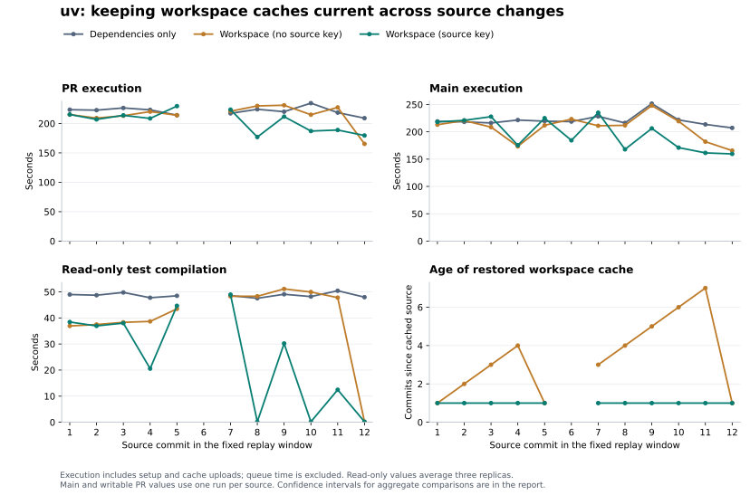

# uv workspace cache refresh across source commits

Compare dependency-only caches with workspace caches whose keys omit or include a source
fingerprint. All saved entries are immutable; the source fingerprint lets a successful writer create
a new entry after a source change.

In this replay's modeled PR workload, workspace caches with a source key averaged 10.8 seconds
faster than workspace caches without a source key. Gains were concentrated in workflow changes and
changes with smaller rebuilds. Changes to shared workspace code still required substantial
compilation. The main and combined PR-plus-main intervals include no gain over the workspace cache
without a source key.

In this replay, the source-key arm uploaded a new entry for each source commit: twelve uploads
totaling 9.34 GiB instead of two totaling 1.56 GiB. For the final workflow-only commit, both
workspace variants already reused the test build; the source-key arm was 14.3 seconds slower in one
writable PR-like sample and saved a new cache. Refreshing trades repeated rebuilds for additional
uploads; the balance depends on which artifacts the next source change can reuse.

## Execution time

Each duration is averaged across source commits. Speedup divides the comparison arm's mean duration
by the source-key arm's mean duration; parentheses show 90% confidence intervals for that ratio.
Values below 1× indicate a slowdown.

| Workload                   | Comparison                | Comparison (s) | Source key (s) |   Speedup (90% CI) |
| -------------------------- | ------------------------- | -------------: | -------------: | -----------------: |
| PR (11 commits)            | Workspace (no source key) |          214.7 |          203.8 | 1.05× (1.00–1.11×) |
| PR (11 commits)            | Dependencies only         |          221.2 |          203.8 | 1.09× (1.04–1.14×) |
| Main (12 commits)          | Workspace (no source key) |          207.4 |          196.1 | 1.06× (0.99–1.14×) |
| Main (12 commits)          | Dependencies only         |          221.0 |          196.1 | 1.13× (1.05–1.21×) |
| One PR + main (12 commits) | Workspace (no source key) |          404.2 |          382.9 | 1.06× (0.99–1.13×) |
| One PR + main (12 commits) | Dependencies only         |          423.8 |          382.9 | 1.11× (1.05–1.17×) |

Execution time includes setup, compilation, tests, cleanup, and cache uploads. Queue time is
excluded. The combined row models one PR-like run plus one main-like run per eligible source commit;
a commit skipped by the PR planner contributes only its main-like run.



## Replay design

The fixed window contains twelve consecutive commits, from
[`834e65e7`](https://github.com/astral-sh/uv-dev/commit/834e65e7b43f6a20b595dd6a93c342f09df2590f)
through
[`6fe4f0f5`](https://github.com/astral-sh/uv-dev/commit/6fe4f0f5cfa8322e97af4479cbfb3d53a3ce9596).
It is the final twelve commits of the preceding thirty-commit study, selected before this replay's
timings were collected. The three arms use the same source, active compiler, runner class, Cargo
settings, and full job commands within each comparison.

The two full-workspace arms use identical pruning logic. The source-key arm can publish rebuilt
workspace artifacts after each source change.

These are workflow-dispatch replays on an experiment branch. Each eligible source commit first
receives three read-only replicas per arm. A writable producer then runs before the next source
commit, saving a new entry on a miss when the cache permits. Producers also run for commits skipped
by the PR planner.

The normal PR estimate follows uv's path-based cache-write policy. Commits allowed to write use the
first writable producer as their PR sample; other commits use the mean of the three read-only
replicas. Depot shares caches across branches, so writable PRs are followed by a separate exact-hit
main replay. Other commits use their producer as the main sample. This gives eleven PR source
commits and twelve main source commits.

All three arms install system packages before restoring Rust caches and installing Python, as in
[#2992](https://github.com/astral-sh/uv-dev/pull/2992).

[Depot Cache shares entries across branches](https://depot.dev/docs/cache/integrations/github-actions).
Cache identities, saved archive sizes, and restored source lineage are checked for every job. Each
arm has an isolated namespace. The PR-like and main-like runs use the same historical source
snapshot and are serialized without competing writers or eviction between them. Initial cache
population is excluded from the timing estimates.

The workspace arm without a source key and the dependency-only arm start at their last recorded
key-changing producer in the previous replay. The source-key arm starts at the immediately preceding
source, representing a policy that was already refreshing caches. The exact seed revisions are
recorded in `metadata.json`.

| Arm                       | Initial cached source                                                                             | Age at first replayed commit (commits) |
| ------------------------- | ------------------------------------------------------------------------------------------------- | -------------------------------------: |
| Dependencies only         | [`0337a04e`](https://github.com/astral-sh/uv-dev/commit/0337a04ec4e92cd756ff5c608e145f647c50937b) |                                      1 |
| Workspace (no source key) | [`0337a04e`](https://github.com/astral-sh/uv-dev/commit/0337a04ec4e92cd756ff5c608e145f647c50937b) |                                      1 |
| Workspace (source key)    | [`0337a04e`](https://github.com/astral-sh/uv-dev/commit/0337a04ec4e92cd756ff5c608e145f647c50937b) |                                      1 |

The paired circular moving-block bootstrap resamples the ordered commit-level observations in blocks
of three, with 50,000 resamples and seed `20261025`. When several read-only replicas are selected,
they are averaged within each source before bootstrapping. Main estimates and any writable PR
estimates use one run per source. Replicas are not treated as independent source changes.
`metadata.json` also includes block-length sensitivities of one, two, and four. These intervals
resample this finite commit sequence; they do not capture all runner variability or establish
performance for arbitrary future changes.

Runner: `depot-ubuntu-24.04-16`. Workflow:
[`25b866a6`](https://github.com/astral-sh/uv-dev/blob/25b866a6840f0c642d078a033094ba41ee6ed1f2/.github/workflows/ci.yml).
Existing action:
[`243f4258`](https://github.com/astral-sh/github-actions/tree/243f4258608cb0f0dace8009ef4c5d8fbd3986c3/rust-workspace-cache).
Refreshing action:
[`7a1c709a`](https://github.com/astral-sh/github-actions/tree/7a1c709a167933c8e64f25b527696f043d5ba885/rust-workspace-cache).

## Cache costs

| Arm                       | New uploads | Uploaded (GiB) | Writer post steps (s total) | Mean read archive (MiB) |
| ------------------------- | ----------: | -------------: | --------------------------: | ----------------------: |
| Dependencies only         |           2 |           0.81 |                        12.0 |                     415 |
| Workspace (no source key) |           2 |           1.56 |                        23.0 |                     797 |
| Workspace (source key)    |          12 |           9.34 |                       131.0 |                     797 |

Upload totals exclude the initial seed. Writer post steps include cleanup, compression, upload, and
action teardown; they are already included in execution time. Archive sizes are means across
read-only replicas.

## Read-only job phases

These diagnostic replicas measure cache reuse without writes before the next producer runs.

| Phase                 | Dependencies only (s) | Workspace (no source key) (s) | Workspace (source key) (s) |
| --------------------- | --------------------: | ----------------------------: | -------------------------: |
| Rust cache restore    |                   3.6 |                           4.5 |                        5.6 |
| Main test compilation |                  48.7 |                          40.0 |                       24.6 |
| Test execution        |                 116.8 |                         118.3 |                      118.9 |
| OS packages           |                  26.7 |                          26.3 |                       26.5 |
| Other job work        |                  25.0 |                          24.6 |                       24.5 |

<details>
<summary>Per-commit PR comparisons</summary>

Positive values mean the workspace cache with a source key finished sooner. The workspace comparison
uses the arm without a source key.

|   # | Source                                                                                          | Change                                                                 | Saved vs dependencies (s) | Saved vs workspace (s) |
| --: | ----------------------------------------------------------------------------------------------- | ---------------------------------------------------------------------- | ------------------------: | ---------------------: |
|   1 | [834e65e7](https://github.com/astral-sh/uv-dev/commit/834e65e7b43f6a20b595dd6a93c342f09df2590f) | Derive deserialization for project source entries (#22880)             |                       8.2 |                   -0.2 |
|   2 | [28ab1fa4](https://github.com/astral-sh/uv-dev/commit/28ab1fa4d1fffbe6f62296fd8eeebd030a1c4dec) | Derive deserialization for workspace references (#22883)               |                      15.7 |                    2.3 |
|   3 | [f7a4df41](https://github.com/astral-sh/uv-dev/commit/f7a4df41ee3fdf3b80746ecb6b5473f26b560d7b) | Derive deserialization for build backend module names (#22884)         |                      12.6 |                   -0.7 |
|   4 | [c559c3bd](https://github.com/astral-sh/uv-dev/commit/c559c3bd8a3d92e03e022dd56ec29eb7a5131bce) | Derive deserialization for tool receipt requirements (#22885)          |                      14.6 |                   11.6 |
|   5 | [ef5b7243](https://github.com/astral-sh/uv-dev/commit/ef5b724387cd61466d825b3fdda18ed318489ff6) | Derive deserialization for exclude-newer values (#22887)               |                     -15.5 |                  -15.5 |
|   6 | [c5fed684](https://github.com/astral-sh/uv-dev/commit/c5fed68440e161dfd18b2c2b2dd5a8744ef824a5) | Document when to use DeserializeUntagged (#22889)                      |                   Skipped |                Skipped |
|   7 | [f158ef25](https://github.com/astral-sh/uv-dev/commit/f158ef25a3cf2fb9bc089ca38cc06f659066f566) | Emit DeserializeUntagged scalar callbacks directly (#22890)            |                      -6.4 |                   -2.7 |
|   8 | [e46bedba](https://github.com/astral-sh/uv-dev/commit/e46bedbacb91322b32e76b797f8828910b1b0dea) | Skip the Azure APT mirror in ARMv7 CI (#22895)                         |                      47.2 |                   53.0 |
|   9 | [f912bc5d](https://github.com/astral-sh/uv-dev/commit/f912bc5d57c126cdf1e333518c5c4f2ca21cb29a) | Remove the unused `Deserialize` derive from `WheelWireSource` (#22891) |                       8.4 |                   19.3 |
|  10 | [15689c8d](https://github.com/astral-sh/uv-dev/commit/15689c8dd573ad32e009d0fdb50ec3fb70315f01) | Skip the Azure APT mirror for Wine, deadsnakes, and musl (#22896)      |                      47.5 |                   27.8 |
|  11 | [1cd8cf12](https://github.com/astral-sh/uv-dev/commit/1cd8cf12bd622f2815406f29e3168d7f052bf1b3) | Use `DeserializeUntagged` for Packse artifact settings (#22892)        |                      29.6 |                   38.5 |
|  12 | [6fe4f0f5](https://github.com/astral-sh/uv-dev/commit/6fe4f0f5cfa8322e97af4479cbfb3d53a3ce9596) | Restore build-script input timestamps in Linux CI (#22904)             |                      29.5 |                  -14.3 |

</details>

## Unsuccessful attempts

Execution-time estimates use successful comparison triplets. The following attempts were replaced
before the next cache writer ran; all three jobs from each attempt remain in
`excluded-samples.json`, including successful siblings.

| Attempt                                                                     | Source # | Dependencies only                                                                                | Workspace (no source key)                                                                        | Workspace (source key)                                                                           |
| --------------------------------------------------------------------------- | -------: | ------------------------------------------------------------------------------------------------ | ------------------------------------------------------------------------------------------------ | ------------------------------------------------------------------------------------------------ |
| [40434070917](https://github.com/astral-sh/uv-dev/actions/runs/40434070917) |        2 | [failure, 219.7s](https://github.com/astral-sh/uv-dev/actions/runs/40434070917/job/121958446305) | [success, 211.9s](https://github.com/astral-sh/uv-dev/actions/runs/40434070917/job/121958446560) | [success, 215.6s](https://github.com/astral-sh/uv-dev/actions/runs/40434070917/job/121958446473) |

Replacement reasons are recorded in `metadata.json` and `excluded-samples.json`. Failed attempts are
not assigned a successful-job speedup.

The dependency-only job failed `test_create_then_move` after Secret Service returned `IsLocked`; the
other two jobs passed.

## Earlier comparisons

The preceding
[thirty-commit study](https://github.com/astral-sh/uv-dev/blob/f72938d78a219b3641ef63e3703ef47c18121f4f/ci-measurements/2026-10-25/README.md)
compares dependency-only caches with workspace caches without source-sensitive keys.
[Earlier action-migration results](earlier-comparisons.md) cover the other CI jobs and include
configurations with no clear gain.

## Reproduce

`samples.csv` contains individual durations, cache lineage, source and workflow revisions, compiler
and runner identities, test counts, compiled workspace packages, pruning counts, and direct job
links. `step-samples.csv` retains the individual GitHub step durations. `log-hashes.json` records
the SHA-256 and size of each collected runner log. `manifest.json` fixes the source history and
replay settings. `excluded-samples.json` retains unsuccessful comparison attempts and their
replacement reasons.

```sh
uv run --script summarize.py
uv run --script render.py
```

The standalone script independently selects PR and main samples, checks the recorded cache lineage,
and recomputes all displayed comparisons and bootstrap sensitivities from the CSV. It checks its
results against `metadata.json`.
